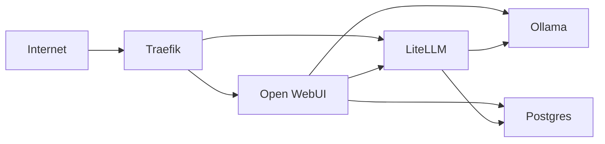

# llm-configs

GitOps Compose stack for shared LLM access on one MIG slice of an NVIDIA H200. Researchers use a chat UI or an OpenAI-compatible API. They do not get a shell on the host.

A systemd timer on the host runs `git fetch` and `git reset --hard origin/main`, then `docker compose pull` and `docker compose up --detach`. There is no webhook and no push-to-deploy workflow.



Ollama and Postgres publish no host ports. Only Traefik listens on 80 and 443.

LiteLLM trusts Traefik’s `X-Forwarded-*` headers from any peer (PoC) so spend logs show the client IP from `X-Forwarded-For` instead of the Traefik container address. `PROXY_BASE_URL` is set to `https://llm.$BASE_DOMAIN`.

## PoC only — replace before production

This checkout favors a working default over hardening:

- Postgres superuser is `postgres` with a hard-to-guess default password set in Compose (`p9Kx2mQ7vL4nR8wT`). Still plaintext in git.
- Traefik dashboard Basic Auth is `admin` / `admin`.
- LiteLLM UI user is `admin`. The password is `LITELLM_MASTER_KEY` from `litellm.env`.
- Open WebUI chat uses a dedicated LiteLLM virtual key (`LITELLM_OPENWEBUI_KEY`). Compose defaults it and `litellm-bootstrap` creates it in LiteLLM on first boot. Direct API callers still create their own keys in the LiteLLM admin UI.
- Open WebUI passwords default to `admin`, `researcher`, and `user` (`WEBUI_ADMIN_PASSWORD`, `RESEARCHER_PASSWORD`, `USER_PASSWORD` in `.env`).
- Do not change `LITELLM_SALT_KEY` after the database exists; stored secrets cannot be decrypted with a new salt.
- Nothing here restricts SSH or other host ports.

## What you must set

Host-level values live in the project `.env` (Compose interpolation for DNS and the MIG device). Service-specific settings live in per-service env files.

```bash
cd /opt/llm-configs
cp .env.example .env
cp ollama.env.example ollama.env
cp litellm.env.example litellm.env
cp openwebui.env.example openwebui.env
# edit .env: set BASE_DOMAIN and NVIDIA_VISIBLE_DEVICES
```

| Variable | Example | Purpose |
|----------|---------|---------|
| `BASE_DOMAIN` | `example.org` | Zone for the three public names below |
| `NVIDIA_VISIBLE_DEVICES` | `MIG-xxxxxxxx-xxxx-xxxx-xxxx-xxxxxxxxxxxx` | The one MIG slice this stack may use |

Optional overrides:

- Ollama tuning → [`ollama.env.example`](ollama.env.example)
- LiteLLM master/salt keys → [`litellm.env.example`](litellm.env.example)
- Open WebUI secret → [`openwebui.env.example`](openwebui.env.example)
- `ACME_EMAIL`, `LITELLM_OPENWEBUI_KEY`, Open WebUI passwords → comments in [`.env.example`](.env.example)

App `DATABASE_URL`s are built in Compose from `POSTGRES_USER` / `POSTGRES_PASSWORD`, so they stay aligned with the Postgres service. Override `LITELLM_OPENWEBUI_KEY` in `.env` if you do not want the Compose default; `litellm-bootstrap` creates that exact key (alias `openwebui`) before Open WebUI starts.

### DNS

Create an A, AAAA, or CNAME for each name, aimed at this host:

- `chat.$BASE_DOMAIN` — Open WebUI
- `llm.$BASE_DOMAIN` — LiteLLM
- `traefik-dashboard.$BASE_DOMAIN` — Traefik dashboard

Ports 80 and 443 must be reachable from the Internet. Let's Encrypt uses the HTTP-01 challenge. Traefik redirects other HTTP requests to HTTPS. The account email defaults to `cirg-adm@uw.edu`.

### MIG device

```bash
nvidia-smi --list-gpus
```

A sliced GPU lists a `MIG-…` UUID under the physical GPU. Put that UUID in `NVIDIA_VISIBLE_DEVICES`. Compose passes it to the Ollama container as `NVIDIA_VISIBLE_DEVICES` and as the NVIDIA device reservation, so this project stays on that slice.

The host needs Docker Engine, the Compose plugin, and the NVIDIA container toolkit.

## First boot

Clone this repo to `/opt/llm-configs` (the systemd unit uses that path). Copy the env examples above, set `.env`, then:

```bash
docker compose up --detach
```

Postgres creates databases `litellm` and `openwebui` from [`postgres/init/01-databases.sql`](postgres/init/01-databases.sql) the first time the data volume is empty. A `keycloak` database is left commented for later. Init does not run again on an existing volume.

No Ollama models are pulled for you. Model weights persist in the named volume `ollama-models`.

Ollama tuning defaults live in [`ollama.env.example`](ollama.env.example) (`OLLAMA_MAX_LOADED_MODELS`, `OLLAMA_NUM_PARALLEL`, `OLLAMA_MAX_QUEUE`, `OLLAMA_KEEP_ALIVE`, `OLLAMA_FLASH_ATTENTION`).

## Accounts

PoC credentials by service. Open WebUI signup is disabled.

| Service | Where | Login / key | Password / secret | Purpose |
|---------|-------|-------------|-------------------|---------|
| Open WebUI | `https://chat.$BASE_DOMAIN` | `admin@localhost` | `WEBUI_ADMIN_PASSWORD` (default `admin`) | Chat UI admin (users, model pull) |
| Open WebUI | same | `researcher@localhost` | `RESEARCHER_PASSWORD` (default `researcher`) | Chat UI standard user |
| Open WebUI | same | `user@localhost` | `USER_PASSWORD` (default `user`) | Second chat UI user |
| LiteLLM | `https://llm.$BASE_DOMAIN/ui` | `admin` | `LITELLM_MASTER_KEY` | Management UI (create keys, spend) |
| LiteLLM | Open WebUI → LiteLLM | Bearer `LITELLM_OPENWEBUI_KEY` | — | Virtual key for Open WebUI chat; created by `litellm-bootstrap` |
| LiteLLM | `https://llm.$BASE_DOMAIN` API | Bearer (your virtual key) | — | Direct OpenAI-compatible REST; create keys in the LiteLLM UI |
| Ollama | internal Docker network only | — | — | No public login. Model pull goes through Open WebUI admin; inference goes through LiteLLM |

Open WebUI accounts are created only when its user table is empty. An existing `postgres-data` volume keeps the previous `admin@$BASE_DOMAIN` accounts until that volume is recreated.

`litellm-bootstrap` creates the Open WebUI virtual key from `LITELLM_OPENWEBUI_KEY` after LiteLLM is healthy (models: `all-proxy-models`). Open WebUI waits for that job to finish.

The Open WebUI admin pulls models in **Admin Settings → Models → Pull a model from Ollama.com**. That request goes straight to Ollama. Bare Ollama ids are hidden from the chat picker so inference does not skip the proxy. After a pull, chat (and `GET /v1/models`) shows the model as `ollama/<tag>`, for example `ollama/llama3.2:latest`. Those calls go to LiteLLM with `LITELLM_OPENWEBUI_KEY`.

```bash
curl "https://llm.${BASE_DOMAIN}/v1/chat/completions" \
  --header "Authorization: Bearer ${YOUR_LITELLM_VIRTUAL_KEY}" \
  --header "Content-Type: application/json" \
  --data '{"model":"ollama/llama3.2","messages":[{"role":"user","content":"Hello"}]}'
```

The Traefik dashboard is `https://traefik-dashboard.$BASE_DOMAIN` with Basic Auth `admin` / `admin`.

## systemd timer

The timer tracks `origin/main`. Merge this branch to `main` before enabling it, and keep a remote named `origin`. `.env` and the service `*.env` files are gitignored, so a reset does not delete them.

If the clone is not `/opt/llm-configs`, edit `WorkingDirectory` and `ExecStart` in [`deploy/llm-gitops.service`](deploy/llm-gitops.service) first.

```bash
sudo cp deploy/llm-gitops.service deploy/llm-gitops.timer /etc/systemd/system/
sudo systemctl daemon-reload
sudo systemctl enable --now llm-gitops.timer
```

The timer waits 2 minutes after boot, then runs 5 minutes after each successful start (`OnUnitActiveSec=5min`). Logs go to the journal and to `/var/log/llm-gitops.log`.

```bash
systemctl list-timers llm-gitops.timer
journalctl --unit llm-gitops.service
```

## Rotating the PoC passwords

- **Postgres.** Change `POSTGRES_PASSWORD` in Compose (or set it in the project `.env`). App `DATABASE_URL`s pick up the new value automatically. The init SQL does not contain the password. Changing the variable does not alter a database that already exists. On a live volume, `ALTER USER postgres WITH PASSWORD '…'` inside the container, then recreate the app containers. To start over, remove the `postgres-data` volume (that deletes chat history and LiteLLM keys).
- **Open WebUI.** Change passwords in the admin UI for existing users. `WEBUI_ADMIN_PASSWORD` / `RESEARCHER_PASSWORD` / `USER_PASSWORD` in `.env` apply only on first boot (empty user table / bootstrap create). Rotate `WEBUI_SECRET_KEY` in `openwebui.env`; existing sessions stop working.
- **LiteLLM master key.** Change `LITELLM_MASTER_KEY` in `litellm.env` and recreate the LiteLLM container. Leave `LITELLM_SALT_KEY` alone once the database exists. Rotate Open WebUI’s key by setting a new `LITELLM_OPENWEBUI_KEY` in `.env`, deleting the old `openwebui` key in the LiteLLM UI if needed, then recreating `litellm-bootstrap` and Open WebUI.
- **Traefik dashboard.** Generate a new apr1 hash (`openssl passwd --apr1`) and replace the `dashboard-auth` label. In the Compose file write each `$` as `$$`.

## Not in this iteration

- No OIDC or Keycloak yet. Commented placeholders are on the Open WebUI service and in [`litellm/config.yaml`](litellm/config.yaml). The Postgres init script has a commented `keycloak` database.
- No vLLM. [`litellm/config.yaml`](litellm/config.yaml) has a commented `vllm/*` model block for a later service.
- No usage guardrails beyond LiteLLM's default per-key accounting. `max_budget`, `rpm_limit`, and `tpm_limit` are left unset; tighten them on each virtual key in the LiteLLM admin UI.
- No firewall rules for SSH or other host ports.
